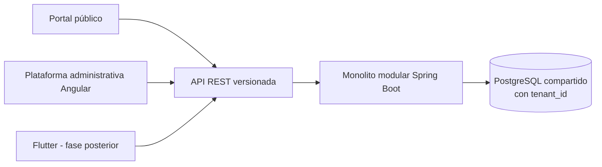

# RefugiaPet

> **Tecnología que protege vidas.**

RefugiaPet Technologies crea herramientas digitales para que los albergues, organizaciones de protección animal y rescatistas puedan dedicar más tiempo al bienestar animal y menos a tareas administrativas dispersas.

## El problema

Muchos albergues administran mascotas, adopciones, donaciones, inventario y voluntariado con hojas de cálculo, papel y mensajería. Esa fragmentación puede dificultar la trazabilidad de los cuidados, la atención a adoptantes y la toma de decisiones. Estas son hipótesis de producto que validaremos con organizaciones reales; no representan investigación concluida.

## Nuestra propuesta

RefugiaPet será un SaaS multi-tenant que centraliza la operación de cada albergue, con aislamiento de datos por organización y un portal público separado para adopciones y donaciones. No incorpora inteligencia artificial como funcionalidad del producto.

## Ecosistema

| Experiencia | Propósito |
| --- | --- |
| RefugiaPet Manager | Administración operativa de albergues. |
| RefugiaPet Adopt | Catálogo público y solicitudes de adopción. |
| RefugiaPet Care | Historial y operación veterinaria. |
| RefugiaPet Donate | Registro de donaciones y transparencia. |
| RefugiaPet Stock | Inventario y alertas. |
| RefugiaPet Connect | Voluntariado y comunidad. |
| RefugiaPet Analytics | Indicadores y reportes. |
| RefugiaPet Mobile | Experiencia móvil posterior al MVP web. |

## Arquitectura inicial

El backend será un monolito modular con Java 21 y Spring Boot; el panel administrativo utilizará Angular y TypeScript; PostgreSQL almacenará los datos; Flutter se evaluará después de validar el MVP web. Docker Compose apoyará el entorno local.

## Repositorios oficiales

- [Backend](https://github.com/RefugiaPet/refugiapet-backend)
- [Frontend](https://github.com/RefugiaPet/refugiapet-frontend)
- [Mobile](https://github.com/RefugiaPet/refugiapet-mobile)
- [Landing](https://github.com/RefugiaPet/refugiapet-landing)
- [Infraestructura](https://github.com/RefugiaPet/refugiapet-infrastructure)
- [Documentación](https://github.com/RefugiaPet/refugiapet-docs)

## Roadmap

El primer objetivo es un MVP web: autenticación, registro de albergues, miembros con permisos, aislamiento multi-tenant, mascotas, catálogo público, solicitudes de adopción, donaciones, inventario básico y dashboard. Los módulos clínicos, voluntariado, rescates, suscripciones, pagos y la aplicación móvil se abordarán después de validar el MVP.

## Estado

Fase 0 — Foundation: repositorios y documentación inicial en preparación. No hay despliegues, clientes, métricas ni integraciones de pago declaradas.
